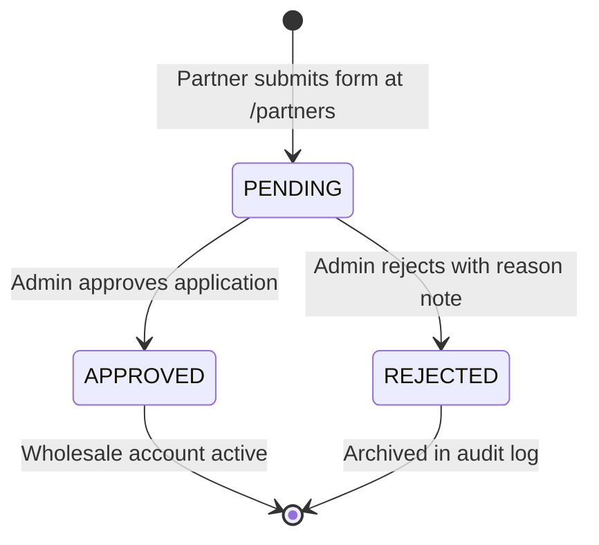

# Data Model: Review Partner Requests in Admin Dashboard

**Feature**: `026-partner-requests-review`  
**Date**: 2026-10-13  
**Status**: Complete

---

## 1. Entities & Database Schema

The Prisma models and enums already exist in `prisma/schema.prisma` from earlier foundation work:

### `PartnerApplication` (جدول درخواست‌های همکاری)

Represents an inbound commercial wholesale application submitted via `/partners`.

```prisma
model PartnerApplication {
  id         Int                      @id @default(autoincrement())
  entityType PartnerEntityType
  status     PartnerApplicationStatus @default(PENDING)

  // Shared applicant details
  fullName          String
  mobile            String   @unique // E.164 normalized format, e.g. +989123456789
  nationalCode      String   // 10 digits
  shopName          String
  shopAddress       String
  leaseDocumentPath String?  // Filename in storage/partners/

  // Individual (حقیقی) fields
  businessLicensePath String?
  postalCode          String?  // 10 digits
  shopPhone           String?  // Landline or mobile with area code

  // Corporate / Legal (حقوقی) fields
  companyName            String?
  companyAddress         String?
  registrationNoticePath String?
  legalNationalId        String?  // 11 digits
  economicCode           String?  // 12 digits

  // Request metadata
  ipAddress String?
  userAgent String?

  // Review & decision fields
  notes       String?   // Review note or rejection rationale
  reviewedBy  Int?      // Foreign key to User (Admin)
  reviewedByRel User?   @relation("PartnerReviewer", fields: [reviewedBy], references: [id], onDelete: SetNull)
  reviewedAt  DateTime?

  createdAt DateTime @default(now())
  updatedAt DateTime @updatedAt

  @@index([entityType])
  @@index([status])
  @@index([createdAt])
  @@map("partner_applications")
}
```

### `User` (جدول کاربران)

```prisma
model User {
  id           Int      @id @default(autoincrement())
  phoneNumber  String?  @unique
  role         Role     @default(RETAIL) // Elevated to WHOLESALE upon application approval
  shopName     String?  // Associated shop or trade name
  isActive     Boolean  @default(true)
  // ... other user fields

  reviewedPartnerApplications PartnerApplication[] @relation("PartnerReviewer")
}
```

---

## 2. Enums & Status Lifecycle

### `PartnerApplicationStatus`
- `PENDING` («در انتظار بررسی»): Initial state upon public submission. Awaits admin inspection.
- `APPROVED` («تأییدشده»): Admin verified credentials; user account upgraded to `Role.WHOLESALE`.
- `REJECTED` («ردشده»): Application rejected; reason recorded in `notes`.



---

## 3. State Transition Matrix & Invariants

| From State | Event | Target State | Invariants & Side Effects |
|:---|:---|:---|:---|
| `PENDING` | Admin Click "تأیید" (`APPROVE`) | `APPROVED` | 1. `reviewedBy = session.adminId`<br>2. `reviewedAt = now()`<br>3. Upsert `User` with `phoneNumber = application.mobile`, set `role = Role.WHOLESALE` and `shopName = application.shopName`. |
| `PENDING` | Admin Click "رد" (`REJECT`) | `REJECTED` | 1. `reviewedBy = session.adminId`<br>2. `reviewedAt = now()`<br>3. `notes = rejectionReason` (required min 3 chars). |
| `APPROVED` / `REJECTED` | Any decision attempt | - | Blocked: cannot transition already finalized application without explicit override. |

