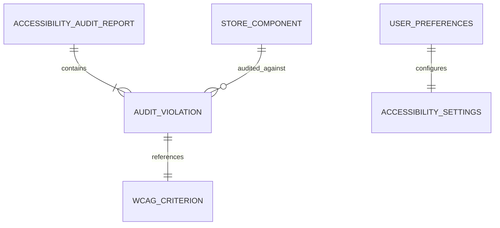

# Data Model: Accessibility Compliance & Audit Entities

**Feature**: `027-accessibility-compliance`  
**Date**: 2026-10-13  
**Status**: Completed  

---

## 1. Entities Overview

Accessibility compliance is primarily client-side UI and structural semantics; however, systematic verification, audits, and preferences require structured models and state definitions.

---

## 2. Entity Definitions

### 1. `AccessibilityAuditReport`
Represents an automated or manual WCAG 2.2 evaluation run on a specific route.

| Field | Type | Description |
|---|---|---|
| `id` | `string` | Unique report identifier (e.g., `audit-storefront-20261013`) |
| `route` | `string` | Target URL/route evaluated (e.g. `/`, `/partners`, `/admin/partners`) |
| `timestamp` | `ISO8601` | Date and time the audit was performed |
| `score` | `number` | Computed compliance percentage (0–100) |
| `violationsCount` | `number` | Total number of non-compliant items detected |
| `status` | `PASS` \| `NEEDS_REMEDIATION` | Overall audit pass/fail outcome |

---

### 2. `AuditViolation`
Represents an individual accessibility defect identified during testing.

| Field | Type | Description |
|---|---|---|
| `id` | `string` | Defect identifier |
| `criterion` | `string` | WCAG 2.2 criterion code (e.g. `1.1.1`, `2.1.1`, `2.4.7`, `2.5.8`) |
| `severity` | `CRITICAL` \| `SERIOUS` \| `MODERATE` | Impact level on assistive technology users |
| `selector` | `string` | DOM selector or component path (e.g. `button.cart-trigger`) |
| `description` | `string` | Persian and English explanation of the failure |
| `remediation` | `string` | Actionable fix instructions |
| `verified` | `boolean` | Whether remediation has been tested and confirmed |

---

### 3. `AccessibilityPreferences`
Represents client accessibility state and assistive mode hooks.

| Field | Type | Description |
|---|---|---|
| `reducedMotion` | `boolean` | Whether user or OS has enabled `prefers-reduced-motion` |
| `highContrast` | `boolean` | Whether high-contrast mode is requested |
| `screenReaderActive` | `boolean` | Heuristic / indicator for screen reader navigation |
| `fontSizeScale` | `number` | Scaling multiplier (1.0, 1.2, 1.5, 2.0) |

---

### 4. `DialogAccessibilityState`
State contract for accessible modals and drawers (`useFocusTrap`).

| Field | Type | Description |
|---|---|---|
| `isOpen` | `boolean` | Dialog visibility |
| `triggerElement` | `HTMLElement \| null` | Reference to the trigger element to restore focus on close |
| `dialogElement` | `HTMLElement \| null` | Reference to modal container receiving initial focus |
| `firstFocusable` | `HTMLElement \| null` | First tabbable node in dialog |
| `lastFocusable` | `HTMLElement \| null` | Last tabbable node in dialog |

