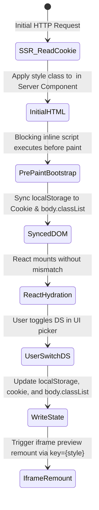

# Data Model: Next.js Multi Design System

**Feature**: `specs/028-nextjs-multi-design-system`  
**Date**: 2026-10-13  
**Status**: Completed  

---

## Entities & Interfaces

### 1. `DesignSystemKey` & `DesignSystemClass`

```typescript
export type DesignSystemKey = "default" | "comfort" | "glass";

export type DesignSystemClass = "style-nova" | "style-vega" | "style-glass";

export interface DesignSystemDefinition {
  id: DesignSystemKey;
  label: string;
  className: DesignSystemClass;
  description: string;
  defaultMode?: "dark" | "light";
  primaryAccent: string;
}
```

### 2. Design System Registry Map

```typescript
export const DESIGN_SYSTEM_MAP: Record<DesignSystemKey, DesignSystemDefinition> = {
  default: {
    id: "default",
    label: "لوکس (نوا)",
    className: "style-nova",
    description: "استایل امضای حامی همراه — ابسیدین عمیق و طلای شامپاینی",
    defaultMode: "dark",
    primaryAccent: "#E5D3B3",
  },
  comfort: {
    id: "comfort",
    label: "راحت (وگا)",
    className: "style-vega",
    description: "استایل مدرن و سبک — پس‌زمینه گرم، کنتراست ملایم و خوانایی بالا",
    defaultMode: "light",
    primaryAccent: "#D97706",
  },
  glass: {
    id: "glass",
    label: "شیشه‌ای (گلس)",
    className: "style-glass",
    description: "استایل فلوئید با افکت‌های بلور و های‌لایت‌های ظریف کریستالی",
    defaultMode: "dark",
    primaryAccent: "#38BDF8",
  },
};
```

---

## State Transition Rules



- **Default Value**: If no cookie or localStorage exists, fall back to `"default"` (`style-nova`).
- **Sanitization**: Any unrecognized or malicious string resolves safely to `"default"`.
- **FOUC Invariant**: At no point between document delivery and final render does the body element contain more than one `style-*` class.

