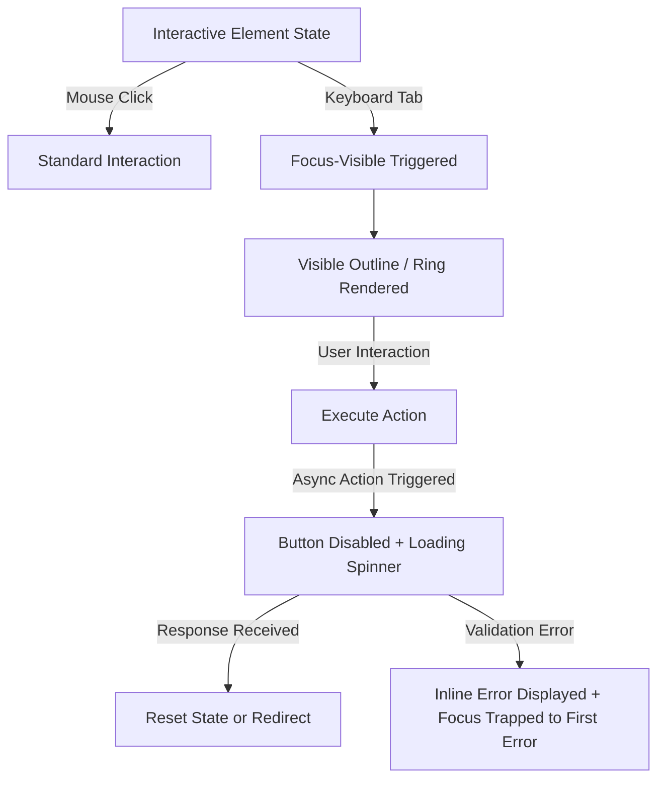

# Data Model: Web Interface Guidelines Compliance

**Feature**: `specs/029-web-interface-guidelines`  
**Date**: 2026-10-13  
**Status**: Completed  

---

## Audit Entities & Types

```typescript
export type GuidelineCategory =
  | "accessibility"
  | "focus_states"
  | "forms"
  | "animation"
  | "typography"
  | "media"
  | "performance"
  | "touch_interaction";

export interface GuidelineRule {
  id: string;
  category: GuidelineCategory;
  name: string;
  description: string;
  selectorOrPattern: string;
  severity: "error" | "warning";
  checkFn: (content: string, filePath: string) => boolean;
}

export interface GuidelineViolation {
  filePath: string;
  lineNumber: number;
  ruleId: string;
  message: string;
  snippet: string;
}
```

---

## State Transition & Interaction Model



---

## Compliance Invariants

1. **Focus Ring Invariant**: An active keyboard focus indicator must have minimum 3:1 contrast against adjacent background colors.
2. **Motion Reduction Invariant**: If `prefers-reduced-motion: reduce` evaluates to true, animation durations collapse to `<= 0.01ms`.
3. **Form Submissions Invariant**: No duplicate POST requests can be fired while an asynchronous request is in flight.

