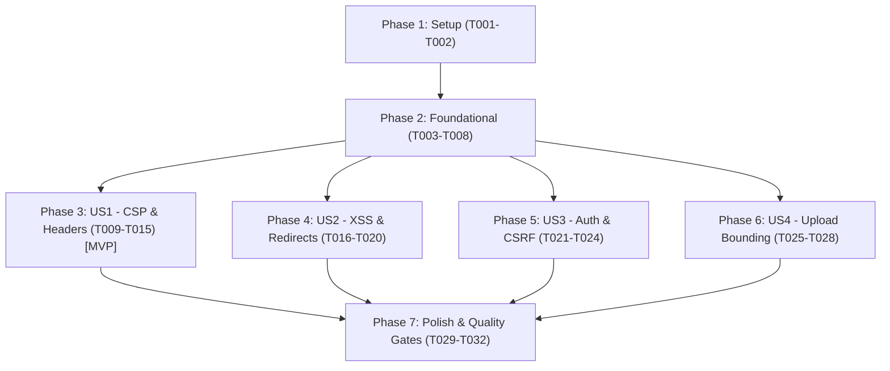

# Implementation Tasks: Frontend Security Hardening

**Feature**: [spec.md](spec.md) | **Plan**: [plan.md](plan.md) | **Branch**: `036-frontend-security`

## Phase 1: Setup (Dependencies & Security Modules)

**Purpose**: Initialize security dependencies and foundational utility structure.

- [X] T001 Install `isomorphic-dompurify` and type definitions in `package.json`
- [X] T002 [P] Create security modules structure in `lib/security/` (`csp.ts`, `static-headers.ts`, `urls.ts`, `sanitize.ts`, `xss.ts`, `csrf.ts`, `upload-validation.ts`)

---

## Phase 2: Foundational (Core Utilities & Contracts)

**Purpose**: Core security helpers that user stories depend on.

**⚠️ CRITICAL**: Must be completed before user stories start.

- [X] T003 [P] Implement static security headers configuration helper in `lib/security/static-headers.ts`
- [X] T004 [P] Implement CSP policy builder and per-request nonce generation helper in `lib/security/csp.ts`
- [X] T005 [P] Implement URL scheme and open redirect validation helpers in `lib/security/urls.ts`
- [X] T006 [P] Implement HTML sanitizer and JSON-LD safe escaping helpers in `lib/security/sanitize.ts` and `lib/security/xss.ts`
- [X] T007 [P] Implement request origin assertion helper in `lib/security/csrf.ts`
- [X] T008 [P] Implement client file upload pre-validation helper in `lib/security/upload-validation.ts`

**Checkpoint**: Foundation ready — all security utility modules implemented and tested.

---

## Phase 3: User Story 1 - Secure Browser Navigation with CSP & Security Headers (Priority: P1) 🎯 MVP

**Goal**: Deliver per-request nonced Content Security Policy and modern HTTP security headers across storefront, back office, and Telegram Mini App.

**Independent Test**: Request storefront pages, admin dashboard, and `/tma` via curl and browser; verify presence of valid CSP with dynamic nonces, `X-Content-Type-Options`, `Referrer-Policy`, `Permissions-Policy`, `frame-ancestors 'none'` on main routes, and Telegram framing on `/tma`.

### Tests for User Story 1

- [X] T009 [P] [US1] Unit test CSP builder and nonce generation logic in `tests/unit/frontend-security-headers.test.ts`
- [X] T010 [P] [US1] Unit test static security headers configuration in `tests/unit/frontend-security-headers.test.ts`

### Implementation for User Story 1

- [X] T011 [US1] Register static security headers in `next.config.mjs` via `headers()` for all paths (`/:path*`)
- [X] T012 [US1] Update `middleware.ts` to generate per-request nonces, attach CSP to forwarded request and response headers, and handle `/tma` framing rules while preserving `/admin` access control
- [X] T013 [US1] Update `app/layout.tsx` to read `x-nonce` from request headers and pass `nonce` to inline `<script>` tags
- [X] T014 [US1] Update `components/common/DesignSystemBootstrap.tsx` to accept and apply the `nonce` prop
- [X] T015 [US1] Update `app/(tma)/layout.tsx` to read `x-nonce` and pass `nonce` to the Telegram Web App script

**Checkpoint**: User Story 1 complete — all pages deliver nonced CSP and security headers without hydration or FOUC regressions.

---

## Phase 4: User Story 2 - XSS Prevention, Safe Link Navigation & Open Redirect Defense (Priority: P1)

**Goal**: Ensure dynamic markup is safely sanitized, inline JSON scripts cannot break out, external links use safe protocols and window isolation, and login redirects are strictly bounded.

**Independent Test**: Submit malicious script payloads, protocol-relative URLs (`//evil.com`), backslash bypasses (`/\evil.com`), and javascript: targets to search, redirects, and links; verify that scripts never execute and redirection defaults to safe internal paths.

### Tests for User Story 2

- [X] T016 [P] [US2] Unit tests for URL protocol allowlist and redirect validation in `tests/unit/frontend-security-urls.test.ts`
- [X] T017 [P] [US2] Unit tests for HTML sanitization and JSON-LD escaping in `tests/unit/frontend-security-sanitize.test.ts`

### Implementation for User Story 2

- [X] T018 [US2] Harmonize `lib/safe-next-path.ts` with `lib/security/urls.ts` for unified safe redirect validation
- [X] T019 [US2] Integrate `escapeJsonLd` into `app/layout.tsx` and `app/(main)/shop/[slug]/page.tsx`
- [X] T020 [US2] Verify and enforce `rel="noopener noreferrer"` and safe protocol validation on external links across storefront components

**Checkpoint**: User Story 2 complete — XSS vectors, script breakout vulnerabilities, and open redirect flaws are thoroughly mitigated.

---

## Phase 5: User Story 3 - Credential Isolation & Anti-CSRF Mutation Defense (Priority: P2)

**Goal**: Prevent client-side token leakage and defend state-changing API endpoints and actions against Cross-Site Request Forgery.

**Independent Test**: Inspect browser storage to verify absence of session credentials in `localStorage`/`sessionStorage`; send POST/PATCH requests from cross-site origins and verify origin assertion rejects unauthorized mutations.

### Tests for User Story 3

- [X] T021 [P] [US3] Unit tests for origin verification and CSRF defenses in `tests/unit/frontend-security-csrf.test.ts`

### Implementation for User Story 3

- [X] T022 [US3] Update `lib/api-client.ts` (`apiMutate`) to attach `X-Hami-Client: web` on all client mutation requests
- [X] T023 [US3] Integrate `assertSameOrigin` assertion into state-modifying API endpoints in `app/api/` to guard against cross-origin mutations
- [X] T024 [US3] Verify that client authentication state in `components/providers/AuthProvider.tsx` relies solely on HTTP-only cookie session and does not persist tokens to `localStorage`

**Checkpoint**: User Story 3 complete — credentials remain isolated in HTTP-only cookies and mutations are defended against cross-site requests.

---

## Phase 6: User Story 4 - Safe File Upload & Client Input Bounding (Priority: P3)

**Goal**: Provide instant Persian client-side validation for file uploads (size caps, MIME allowlists, active SVG blocking) before network transmission.

**Independent Test**: Attempt selecting files >5MB/10MB or disallowed file extensions (`.svg`, `.html`, `.exe`) in catalog image upload and partner document upload forms; verify instant Persian rejection error.

### Tests for User Story 4

- [X] T025 [P] [US4] Unit tests for client file upload pre-validation in `tests/unit/frontend-security-upload.test.ts`

### Implementation for User Story 4

- [X] T026 [US4] Integrate `validateUploadFile` into `components/admin/CatalogImageManager.tsx`
- [X] T027 [US4] Integrate `validateUploadFile` into `components/admin/bundles/BundleFormModal.tsx` and `components/admin/products/VariantPhotoPicker.tsx`
- [X] T028 [US4] Harmonize file validation in `components/partners/PartnerForm.tsx` with `lib/security/upload-validation.ts`

**Checkpoint**: User Story 4 complete — file upload forms enforce client-side constraints with Persian user feedback before upload.

---

## Phase 7: Polish & Quality Gates

**Purpose**: End-to-end verification and quality gate enforcement across the entire codebase.

- [X] T029 [P] Run `npm run typecheck` to verify zero TypeScript errors
- [X] T030 [P] Run `npm run test:unit` to verify all unit tests pass clean
- [X] T031 Run Next.js production build (`npm run build`) to ensure zero build or bundling errors
- [X] T032 Verify quickstart verification checklist in `specs/036-frontend-security/quickstart.md`

---

## Dependencies & Execution Order

### Phase Dependencies

### Parallel Opportunities

- Within Phase 2: T003, T004, T005, T006, T007, T008 can all be developed in parallel as separate utility files.
- Tests (T009, T010, T016, T017, T021, T025) can be created in parallel with implementation.
- User Stories 1 through 4 can be implemented incrementally without cross-story blocking.

---

## Implementation Strategy

### MVP First (User Story 1 Only)
1. Complete Phase 1 (Setup) and Phase 2 (Foundational utilities).
2. Complete Phase 3 (User Story 1: CSP & Security Headers).
3. Verify headers on `http://localhost:3000/` and `/admin` with curl and browser.

### Incremental Delivery
1. Foundation + US1 (CSP nonces, static headers, Telegram framing) -> Core perimeter secured.
2. US2 (XSS, JSON-LD, URL and redirect validation) -> Injection and phishing vectors neutralized.
3. US3 (Cookie auth isolation and CSRF origin checks) -> Session state protected.
4. US4 (Upload constraints and Persian validation feedback) -> Hostile payload uploads blocked.
5. Polish & Verification -> Typecheck, unit test suites, production build clean.
