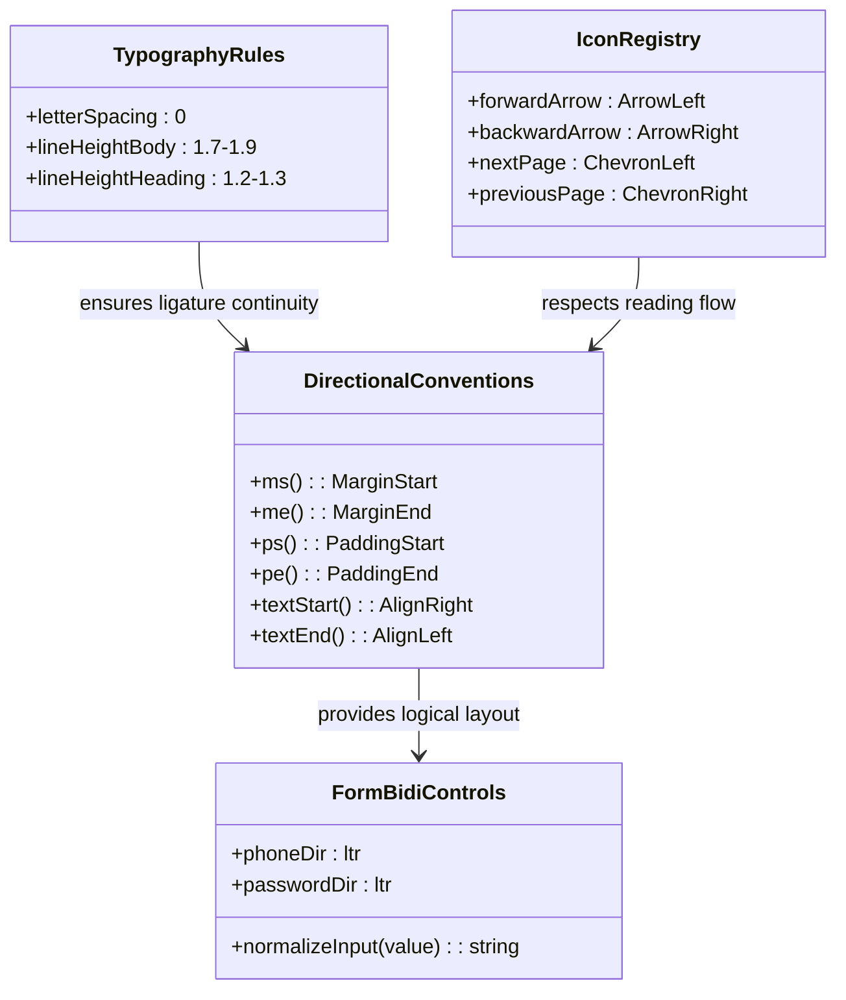

# Data Model: Persian RTL UI & Normalization Primitives

**Feature**: [spec.md](spec.md) | **Branch**: `037-persian-rtl-ui`

---

## 1. Entities & Types

### A. RTL Directional Token

```typescript
export type DirectionalAxis = "start" | "end" | "top" | "bottom";

export interface LogicalPadding {
  start?: string | number; // maps to ps-*
  end?: string | number;   // maps to pe-*
  top?: string | number;   // maps to pt-*
  bottom?: string | number;// maps to pb-*
}

export interface LogicalMargin {
  start?: string | number; // maps to ms-*
  end?: string | number;   // maps to me-*
  top?: string | number;   // maps to mt-*
  bottom?: string | number;// maps to mb-*
}
```

### B. Digit Normalization Utility Contract

```typescript
export interface DigitNormalizationResult {
  /** ASCII-normalized string suitable for API payloads and DB storage */
  ascii: string;
  /** True if any Persian or Arabic-Indic digits were converted */
  wasConverted: boolean;
}

/**
 * Converts Persian (۰-۹) and Arabic-Indic (٠-٩) digits to standard ASCII (0-9).
 */
export function normalizePersianDigits(input: string): string;

/**
 * Converts ASCII digits (0-9) to Persian numerals (۰-۹) for display.
 */
export function toPersianDigits(input: string | number): string;
```

### C. Currency Display Format

```typescript
export interface PersianCurrencyFormatOptions {
  /** Include unit suffix «تومان» (defaults to true) */
  showUnit?: boolean;
  /** Use Persian numerals ۰-۹ (defaults to true) */
  persianDigits?: boolean;
}

export interface FormattedPrice {
  /** Formatted numeral string with Persian thousands separator, e.g. "۲۵٬۴۰۰٬۰۰۰" */
  formattedNumeral: string;
  /** Currency unit label, e.g. "تومان" */
  unit: "تومان";
  /** Full concatenated string, e.g. "۲۵٬۴۰۰٬۰۰۰ تومان" */
  displayString: string;
}
```

---

## 2. Relationships & Component Integration


