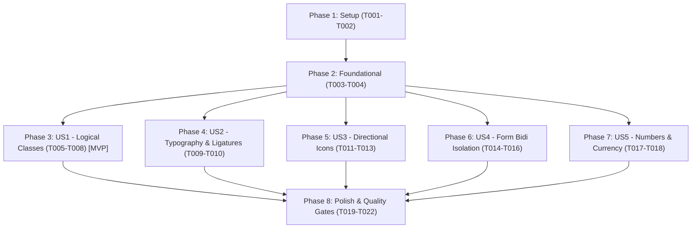

# Implementation Tasks: Persian RTL UI Standards Compliance

**Feature**: [spec.md](spec.md) | **Plan**: [plan.md](plan.md) | **Branch**: `037-persian-rtl-ui`

---

## Phase 1: Setup (Infrastructure & Helper Utilities)

**Purpose**: Set up helper utilities and mirror the Persian RTL UI skill.

- [X] T001 [P] Mirror `persian-rtl-ui` skill into `.cursor/skills/persian-rtl-ui/SKILL.md`
- [X] T002 Implement typography and bidi helper utilities in `lib/persian-typography.ts` (Persian digit normalization, price formatting with «تومان» suffix, `<bdi>` wrapping helper)

---

## Phase 2: Foundational (Test Suite & Lint Scanners)

**Purpose**: Establish regression testing for RTL rules before modifying components.

**⚠️ CRITICAL**: Write tests first to catch regressions in logical classes, tracking, and iconography.

- [X] T003 [P] Create comprehensive RTL unit test suite in `tests/unit/persian-rtl-ui.test.ts` asserting logical properties, zero tracking on Persian text, and digit/price formatting
- [X] T004 [P] Implement automated scan test for physical directional utilities (`ml-`, `mr-`, `pl-`, `pr-`, `text-left`, `text-right`, `space-x-`)

**Checkpoint**: Foundation ready — automated tests verify RTL rules and detect physical directional classes.

---

## Phase 3: User Story 1 - Pure Logical Directional Layout (Priority: P1) 🎯 MVP

**Goal**: Eliminate all remaining physical directional utilities in components and pages, replacing them with standard CSS logical properties (`ms-`, `me-`, `ps-`, `pe-`, `start-`, `end-`, `text-start`, `text-end`, `gap-*`).

**Independent Test**: Scan the codebase with automated tests; assert 0 physical directional classes; verify visually in browser that cards, tables, drawer padding, and modals align flush to the start (right).

### Implementation for User Story 1

- [X] T005 [P] [US1] Refactor admin bundle components (`components/admin/bundles/BundlesAdminClient.tsx`, `components/admin/bundles/BundleFormModal.tsx`) from physical classes (`pr-`, `pl-`, `text-left`, `text-right`) to logical classes (`ps-`, `pe-`, `text-start`, `text-end`)
- [X] T006 [P] [US1] Refactor admin partner components (`components/admin/partners/PartnersAdminClient.tsx`, `components/admin/partners/PartnerApplicationModal.tsx`) from physical classes to logical classes
- [X] T007 [P] [US1] Refactor TMA components (`components/tma/VariantEditorSheet.tsx`, `components/tma/AccessDenied.tsx`) from physical classes to logical classes
- [X] T008 [P] [US1] Refactor UI primitive and shop components (`components/curve-drawer-primitives.tsx`, `components/ui/badge.tsx`, `components/ui/liquid-glass.tsx`, `components/cart/CartLine.tsx`) to logical classes

**Checkpoint**: User Story 1 complete — all components use native CSS logical properties for padding, margin, borders, and text alignment.

---

## Phase 4: User Story 2 - Typography & Letter-Joining Integrity (Priority: P1)

**Goal**: Guarantee continuous cursive ligatures across all Persian headings, buttons, and badges by enforcing `letter-spacing: 0` (`tracking-normal`) and removing `tracking-tight`.

**Independent Test**: Assert that no Persian headline, badge, or copy element carries `tracking-tight`; verify letter continuity in browser.

### Implementation for User Story 2

- [X] T009 [P] [US2] Remove `tracking-tight` from `components/tma/DashboardMetrics.tsx`, `components/tma/TMAHeader.tsx`, and `components/tma/TMABottomNav.tsx`
- [X] T010 [P] [US2] Verify and enforce `letter-spacing: 0` (`tracking-normal`) across all Persian headings in `components/home/`, `components/shop/`, and `components/admin/`

**Checkpoint**: User Story 2 complete — all Persian text renders with unbroken cursive letter connections.

---

## Phase 5: User Story 3 - Directional Icon & Navigation Flow Semantics (Priority: P1)

**Goal**: Align navigation arrows and chevrons with Persian reading direction (forward points left, backward points right).

**Independent Test**: Inspect product cards, pagination, and back buttons; verify that "مشاهده جزئیات", "صفحه بعد", and "ادامه" use left-pointing icons (`ArrowLeft` / `ChevronLeft`), while "بازگشت" and "صفحه قبل" use right-pointing icons (`ArrowRight` / `ChevronRight`).

### Implementation for User Story 3

- [X] T011 [P] [US3] Invert forward CTA arrows in `components/shop/ProductCard.tsx` (replace `ArrowRight` with `ArrowLeft` for "مشاهده جزئیات / خرید")
- [X] T012 [P] [US3] Invert pagination chevrons in `components/admin/ui/Pagination.tsx` (`ChevronLeft` for next page, `ChevronRight` for previous page)
- [X] T013 [P] [US3] Verify back/return navigation icons across admin and storefront (`components/admin/orders/OrdersAdminClient.tsx`, `components/admin/orders/OrderAdminDetailClient.tsx`, `components/shop/ProductListRow.tsx`)

**Checkpoint**: User Story 3 complete — directional icons strictly adhere to RTL chronological and reading flow.

---

## Phase 6: User Story 4 - Form Fields Bidi Isolation & Normalization (Priority: P2)

**Goal**: Isolate LTR data entry for password, phone, card, and code fields under RTL labels, and automatically normalize Persian/Arabic-Indic digits.

**Independent Test**: Enter passwords, telephone numbers, and Persian numerals in login, register, and checkout forms; verify cursor stability and ASCII normalization on submission.

### Implementation for User Story 4

- [X] T014 [P] [US4] Add `dir="ltr"` to password and phone inputs in `components/auth/LoginForm.tsx` and `components/auth/RegisterForm.tsx`
- [X] T015 [P] [US4] Add `dir="ltr"` and `inputMode="tel"` to phone and numeric fields in `components/partners/PartnerForm.tsx` and `components/checkout/CheckoutClient.tsx`
- [X] T016 [US4] Integrate digit normalization helper into form submissions so Persian numerals (`۰۱۲۳۴۵۶۷۸۹`) convert to ASCII before validation

**Checkpoint**: User Story 4 complete — form inputs handle bidirectional content seamlessly without cursor jumping.

---

## Phase 7: User Story 5 - Numerals, Jalali Dates & Currency Formatting (Priority: P2)

**Goal**: Ensure visible prices use Persian numerals followed by «تومان» and tabular numbers align to `text-start`.

**Independent Test**: Inspect catalog and admin views; verify prices display `[عدد] تومان` and table numbers align right.

### Implementation for User Story 5

- [X] T017 [P] [US5] Verify that all visible price amounts are followed by «تومان» and formatted with Persian digits
- [X] T018 [P] [US5] Ensure numeric table columns in admin use `tabular-nums` and align to `text-start`

**Checkpoint**: User Story 5 complete — price and numeric formatting adheres to Iranian market conventions.

---

## Phase 8: Polish & Quality Gates

**Purpose**: Full regression suite and production verification.

- [X] T019 [P] Run `npm run typecheck` to verify zero TypeScript errors
- [X] T020 [P] Run `npm run test:unit` to verify all 62+ unit test suites pass
- [X] T021 Run `npm run build` to ensure clean Next.js production build
- [X] T022 Perform visual verification in mobile viewport (390x844) via Playwright

---

## Dependencies & Execution Order

